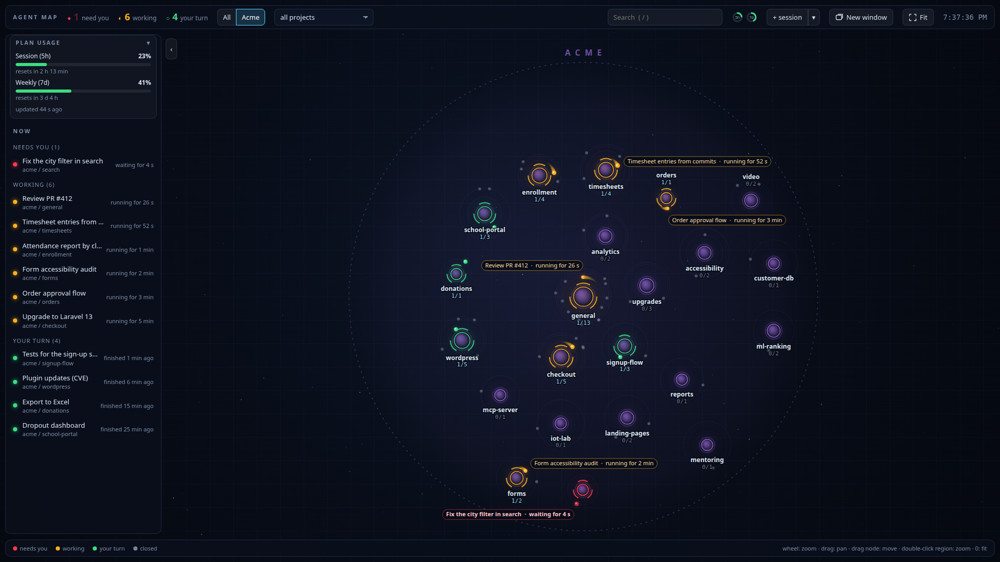
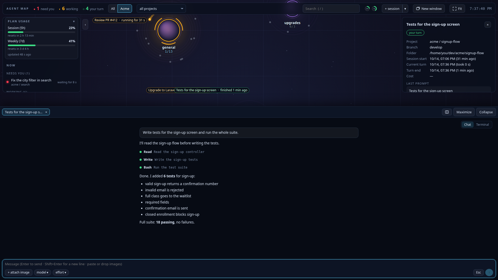

# Claude Agent Map

**English** · [Português](README.pt-BR.md)

A live map of every [Claude Code](https://claude.com/claude-code) session on your machine. Each project is a point on the map and each session orbits its project, colored by state: **working**, **your turn** or **needs you**. Chat with any agent, answer permission prompts and start new sessions without switching windows.



Running agents in five projects at once usually means five editor windows and a lot of alt-tab to find out which one is waiting for you. The map shows all of them at a glance and puts the ones that need you first.

## Features

- **Every project on one map:** sessions from the terminal, VS Code or the background (`claude --bg`), plus closed ones from the last 14 days.
- **Needs-you first:** a session waiting for a permission turns red, bumps the counter at the top and sends a desktop notification.
- **Built-in chat:** open any background session, send messages and images, switch model and effort, answer permission prompts with buttons. The real terminal is one click away.
- **New session in one click** in the selected project. The tab takes the session's title as soon as it has one.
- **Side by side:** several agents in columns.
- **Plan usage** (5-hour and 7-day windows) always visible.
- **Project from context:** a session started at the root of a workspace is placed on the subproject named in its title or first prompt (typos and aliases included).



## Your Claude account

No API key, no extra login. The app reads Claude Code's local files (`~/.claude`) and runs the `claude` command itself to create, resume and attach to sessions, so **it uses whatever account your Claude Code is logged into**. If Claude Code works on your machine, the map works too.

Plan usage shows up for Pro and Max subscribers: Claude Code passes the limits to the status line (`statusLine`), and the installer adds a small hook that saves them for the map.

## Requirements

- Linux with systemd (the app runs as a `systemd --user` service)
- Python 3.10+ with `aiohttp`
- [Claude Code](https://docs.claude.com/en/docs/claude-code) installed and logged in (`claude`)
- Optional: Google Chrome or Chromium (opens as an app window), `notify-send` (desktop notifications)

## Install

```bash
git clone https://github.com/RodrigoSyprianoRibeiro/claude-agent-map.git ~/dev/claude-agent-map
cd ~/dev/claude-agent-map
pip install --user -r requirements.txt   # or: sudo apt install python3-aiohttp
./install.sh
```

Then open **Agent Map** from your applications menu, or go to <http://127.0.0.1:8767>.

The installer:

1. creates the `mapa-agentes` user service (`systemctl --user status mapa-agentes`), the icon and the launcher;
2. adds two hooks to `~/.claude/settings.json`, backing it up first:
   - `statusLine` → `hooks/status-uso.py`, which saves your plan usage. **If you already have a status line, it is kept**: yours still runs and shows the same line;
   - `Notification` → `hooks/notificacao-sessao.py`, which flags sessions that need you. It is added next to any hooks you already have.

Run `./install.sh --no-hooks` to leave `settings.json` alone. Run the installer again after pulling updates or changing the config.

## Configuration (optional)

With no config, every folder in `~/dev` becomes a region on the map. To group several projects into one big region (with its own focus button and launcher shortcut), create `~/.config/mapa-agentes/config.json`. See [`config.example.json`](config.example.json).

```json
{
  "projectsDir": "~/dev",
  "workspaces": [
    {
      "id": "acme",
      "name": "Acme",
      "path": "~/dev/acme",
      "color": "#b478ff",
      "aliases": { "online-store": ["store", "checkout"] }
    },
    {
      "id": "shop",
      "name": "Shop",
      "path": "~/dev/shop-workspace",
      "siblings": "shop-*",
      "pinned": "shop-*"
    }
  ]
}
```

| Key | What it does |
|---|---|
| `projectsDir` | Where your projects live (default `~/dev`). Each top-level folder becomes a region. |
| `workspaces[].id` | Lowercase id (letters, digits, `-`, `_`), used in the URL (`?foco=acme`). |
| `workspaces[].path` | A folder that groups projects. Each subfolder becomes a node. |
| `name`, `color` | Region label and color (`#rrggbb`). |
| `aliases` | Other names for a subfolder, used to match a session's title or prompt. The folder name itself always works. |
| `siblings` | Folder pattern in `projectsDir` that belongs to the workspace as its own node (worktrees, copies). |
| `pinned` | Subfolders with a `.git` directory matching this pattern are always shown, so you can start sessions there. |
| `remote` | Optional `{"inventory": ".claude/inventory.json", "repoByPath": {...}}` to recognize the repo of a session working on a server over `ssh`. |

## Usage

- **Click** a session in the list: the map centers on it and opens the chat. **Click** a node: selects the project for `+ session`.
- **`+ session`** starts a background session in the selected project; **`▾`** opens options (prompt, name, model, effort).
- **Keys:** `1` all, `2`–`9` workspaces, `0` fit, `/` search, `+` and `-` zoom, `Esc` close details, `Ctrl+Esc` switch between chat and terminal.
- Drag nodes to rearrange them; positions are saved.
- Sessions open in VS Code or in a regular terminal are **read-only** here. To chat from the map, use **Take over here** on a closed session or start one with `+ session`.
- The UI follows your browser language (English or Portuguese). Force it with `?lang=en` or `?lang=pt`.

## Security

Claude Code transcripts contain commands, paths and sometimes secrets, so the server:

- listens on `127.0.0.1` only and rejects requests with a foreign `Host` header (DNS rebinding protection);
- requires a local `Origin` and a per-run token, known only to the page it serves, for every action that runs something (new session, terminal, attachments);
- never takes a path from the page: a new session's folder comes from the server-side layout, and only folders inside your home are allowed.

## Uninstall

```bash
./uninstall.sh
```

Removes the service, the launcher and the hooks (your original `statusLine` comes back). Config and node positions stay in `~/.config/mapa-agentes`.

## Development

```bash
python3 -m unittest discover -s tests
```

End-to-end tests drive the real `claude` CLI (they spend a few tokens) and create and remove a test session on a node of your map:

```bash
E2E=1 E2E_NO=my-project/geral python3 -m unittest discover -s tests -p test_e2e_terminal.py
```

The code was written in Portuguese (identifiers and comments); the UI and docs are bilingual.

## Limitations

- Linux only (uses `/proc`, `systemd --user` and PTYs).
- Reads Claude Code's internal formats (`.jsonl` transcripts, `~/.claude/sessions`), which may change between versions.
- Built-in chat and terminal work with background sessions (`claude --bg`).

This is an independent project, not affiliated with Anthropic. Claude and Claude Code are trademarks of Anthropic.

## License

[MIT](LICENSE). The libraries in `static/vendor` (xterm.js, marked, DOMPurify) keep their own licenses, included in that folder.
