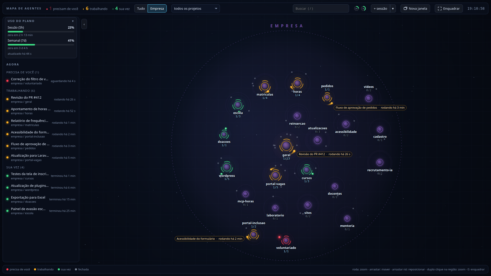
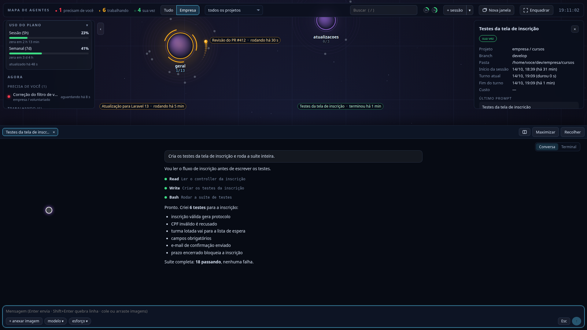

# Mapa de Agentes (Agent Map)

[English](README.md) · **Português**

Um mapa vivo de todas as sessões do [Claude Code](https://claude.com/claude-code) da sua máquina. Cada projeto é um ponto no mapa e cada sessão orbita o seu projeto, com a cor do estado: **trabalhando**, **sua vez** ou **precisa de você**. Dá para conversar com qualquer agente, aprovar permissões e abrir sessões novas sem trocar de janela.



## O que ele faz

- **Mapa de todos os projetos:** sessões abertas no terminal, no VS Code ou em segundo plano, e as fechadas dos últimos 14 dias.
- **Quem precisa de você aparece primeiro:** a sessão que pede permissão fica vermelha, com contador no topo e notificação na área de trabalho.
- **Conversa embutida:** abre a conversa de qualquer sessão em segundo plano (`claude --bg`), envia mensagens e imagens, troca modelo e esforço, aprova permissões por botões. O terminal de verdade fica a um clique.
- **Nova sessão em um clique** no projeto selecionado; a aba ganha o título da sessão assim que ele existe.
- **Vários agentes lado a lado**, em colunas.
- **Uso do plano** (janelas de 5 h e de 7 dias) sempre à vista.
- **Projeto pelo contexto:** sessão aberta na raiz de um workspace vai para o subprojeto citado no título ou no primeiro prompt (aceita erro de digitação e apelidos).



## Sua conta do Claude

O app não usa chave de API nem pede login. Ele lê os arquivos locais do Claude Code (`~/.claude`) e chama o próprio comando `claude` para criar, retomar e conectar sessões. Ou seja, **usa a conta em que o seu Claude Code já está logado**. Quem tiver o Claude Code instalado e logado só precisa instalar o mapa.

O uso do plano aparece para assinantes Pro e Max: o Claude Code informa os limites à linha de status (`statusLine`), e o instalador registra um hook que grava esse dado para o mapa.

## Requisitos

- Linux com systemd (o app roda como serviço `systemd --user`)
- Python 3.10 ou mais novo, com `aiohttp`
- [Claude Code](https://docs.claude.com/en/docs/claude-code) instalado e logado (`claude`)
- Opcional: Google Chrome ou Chromium (abre como janela de app), `notify-send` (notificações)

## Instalação

```bash
git clone https://github.com/RodrigoSyprianoRibeiro/claude-agent-map.git ~/dev/claude-agent-map
cd ~/dev/claude-agent-map
pip install --user -r requirements.txt   # ou: sudo apt install python3-aiohttp
./install.sh
```

Depois abra **Agent Map** no menu de aplicativos, ou acesse <http://127.0.0.1:8767>.

O instalador:

1. cria o serviço `mapa-agentes` (`systemctl --user status mapa-agentes`), o ícone e o atalho;
2. registra dois hooks no `~/.claude/settings.json`, com backup antes de gravar:
   - `statusLine` → `hooks/status-uso.py`, que grava o uso do plano. **Se você já tem um statusLine, ele é mantido**: o seu continua rodando e a linha que você vê não muda;
   - `Notification` → `hooks/notificacao-sessao.py`, que marca a sessão que precisa de você. É somado aos hooks que você já tiver.

Use `./install.sh --no-hooks` para não mexer no `settings.json`. Rode o instalador de novo sempre que atualizar o repositório ou mudar o config.

## Configuração (opcional)

Sem configuração, cada pasta de `~/dev` vira uma região no mapa. Para agrupar vários projetos numa região grande (com botão de foco na barra e atalho no menu), crie `~/.config/mapa-agentes/config.json`. Há um modelo em [`config.example.json`](config.example.json). As chaves valem em inglês (abaixo) ou em português (`pastaProjetos`, `nome`, `pasta`, `cor`, `apelidos`, `irmaos`, `nosFixos`, `remoto`).

```json
{
  "projectsDir": "~/dev",
  "workspaces": [
    {
      "id": "empresa",
      "name": "Empresa",
      "path": "~/dev/empresa",
      "color": "#b478ff",
      "aliases": { "portal-vagas": ["vagas", "recrutamento"] }
    },
    {
      "id": "loja",
      "name": "Loja",
      "path": "~/dev/loja-workspace",
      "siblings": "loja-*",
      "pinned": "loja-*"
    }
  ]
}
```

| Campo | O que faz |
|---|---|
| `projectsDir` | Onde ficam seus projetos (padrão `~/dev`). Cada pasta de primeiro nível vira uma região. |
| `workspaces[].id` | Identificador (minúsculas, números, `-` e `_`), usado na URL (`?foco=empresa`). |
| `workspaces[].path` | Pasta que agrupa projetos. Cada subpasta vira um nó. |
| `name`, `color` | Rótulo e cor (`#rrggbb`) da região. |
| `aliases` | Outros nomes de uma subpasta, para reconhecer o projeto pelo título ou prompt da sessão. O nome da própria pasta já vale sem apelido. |
| `siblings` | Padrão de pastas em `projectsDir` que pertencem ao workspace como nó próprio (worktrees, cópias). |
| `pinned` | Padrão de subpastas com `.git` que aparecem mesmo sem sessão, para abrir sessão nova ali. |
| `remote` | Opcional: `{"inventory": ".claude/inventory.json", "repoByPath": {...}}`, para reconhecer o repositório de uma sessão que trabalha num servidor por `ssh`. |

## Uso

- **Clique** numa sessão da lista: centraliza no mapa e abre a conversa. **Clique** num nó: seleciona o projeto para o `+ sessão`.
- **`+ sessão`** cria uma sessão em segundo plano no projeto selecionado; **`▾`** abre opções (prompt, nome, modelo, esforço).
- A interface segue o idioma do navegador (português ou inglês); force com `?lang=pt` ou `?lang=en`.
- **Atalhos:** `1` tudo, `2` a `9` workspaces, `0` enquadrar, `/` buscar, `+` e `-` zoom, `Esc` fechar o detalhe, `Ctrl+Esc` alternar entre conversa e terminal.
- Arraste os nós para reorganizar; a posição fica salva.
- Sessões abertas no VS Code ou num terminal comum aparecem em **modo leitura**. Para conversar pelo mapa, use **Assumir aqui** numa sessão fechada ou crie a sessão pelo `+ sessão`.

## Segurança

Os transcritos do Claude Code têm comandos, caminhos e às vezes segredos, então o servidor:

- escuta só em `127.0.0.1` e recusa requisições com `Host` diferente (proteção contra DNS rebinding);
- exige `Origin` local e um token gerado a cada início, que só a página servida conhece, em toda ação que executa algo (criar sessão, terminal, anexos);
- nunca aceita caminho vindo da página: a pasta de uma sessão nova sai do layout, e só pastas dentro da sua home.

## Desinstalar

```bash
./uninstall.sh
```

Remove o serviço, o atalho e os hooks (o seu `statusLine` original volta). Config e posições ficam em `~/.config/mapa-agentes`.

## Desenvolvimento

```bash
python3 -m unittest discover -s tests
```

Os testes fim a fim usam o `claude` de verdade (gastam alguns tokens) e criam e removem uma sessão de teste num nó do seu mapa:

```bash
E2E=1 E2E_NO=meu-projeto/geral python3 -m unittest discover -s tests -p test_e2e_terminal.py
```

## Limitações

- Só Linux (usa `/proc`, `systemd --user` e PTY).
- Lê formatos internos do Claude Code (transcritos `.jsonl`, `~/.claude/sessions`), que podem mudar entre versões.
- Conversa e terminal embutidos funcionam com sessões em segundo plano (`claude --bg`).

Projeto independente, sem vínculo com a Anthropic. Claude e Claude Code são marcas da Anthropic.

## Licença

[MIT](LICENSE). As bibliotecas em `static/vendor` (xterm.js, marked, DOMPurify) mantêm as licenças delas, incluídas na mesma pasta.
